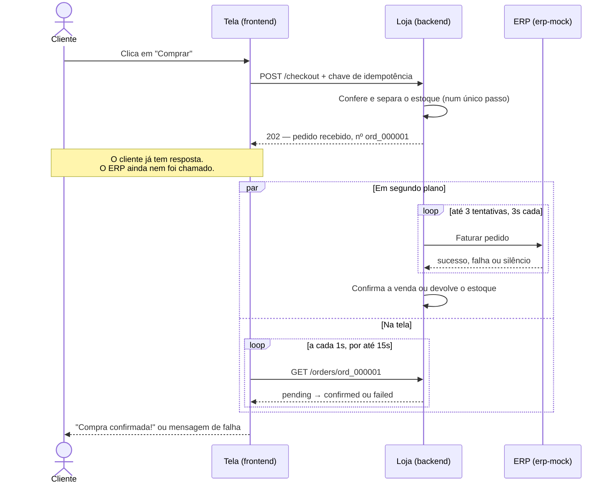
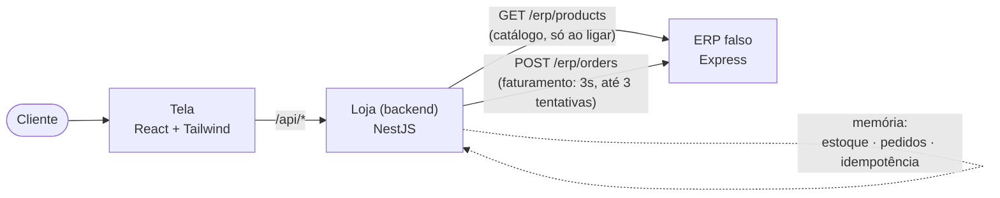
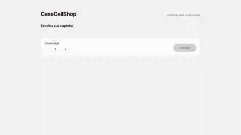
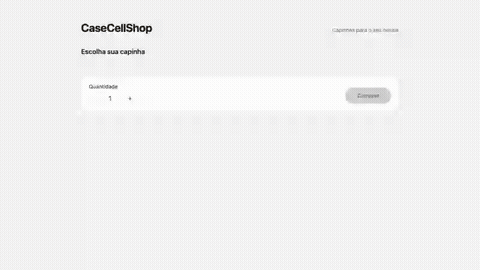

# CaseCellShop — Checkout

Uma versão funcional, de ponta a ponta, da etapa de compra de uma loja online de capinhas de celular. O cliente escolhe um produto e a quantidade, clica em "Comprar", e o sistema garante três coisas:

- **Nunca vende mais do que existe em estoque**, nem quando várias pessoas tentam comprar a última unidade ao mesmo tempo.
- **Nunca cria o mesmo pedido duas vezes**, nem se o cliente clicar duas vezes ou a conexão cair e a requisição for reenviada.
- **Responde rápido ao cliente**, mesmo quando o ERP (o sistema de gestão que fatura os pedidos) está lento ou fora do ar.

> **Analogia:** funciona como uma loja física em que o atendente **separa o produto no balcão** assim que o cliente decide comprar, **entrega uma senha** e confirma o pagamento **nos fundos**, sem deixar o cliente esperando no caixa. Se o pagamento não passar, o produto volta para a prateleira. O resto deste documento usa essa imagem: o balcão é a *reserva de estoque*, a senha é o *número do pedido* e os fundos são o *ERP*.

> **Avaliando o case?** O checklist com onde verificar cada requisito está na [seção 9](#9-checklist-do-case).

O projeto tem três programas independentes, todos em Node.js e sem necessidade de Docker:

| Pasta | O que é | Tecnologia | Porta |
|---|---|---|---|
| `erp-mock/` | Um ERP falso, criado para simular um ERP real lento ou instável | Express | 4000 |
| `backend/` | O servidor da loja: estoque, pedidos e conversa com o ERP | NestJS | 3001 |
| `frontend/` | A tela que o cliente usa | React + Vite + Tailwind | 5173 |
| `e2e/` | Testes que abrem um navegador de verdade e usam a loja como um cliente | Playwright | — |

## Sumário

1. [Como rodar](#1-como-rodar)
2. [Como funciona uma compra](#2-como-funciona-uma-compra)
3. [Testes](#3-testes)
4. [Simulação de ERP lento ou instável](#4-simulação-de-erp-lento-ou-instável)
5. [Contrato da API](#5-contrato-da-api)
6. [Arquitetura e decisões técnicas](#6-arquitetura-e-decisões-técnicas)
7. [Próximos passos](#7-próximos-passos)
8. [Evidências](#8-evidências)
9. [Checklist do case](#9-checklist-do-case)
10. [Leitura complementar](#10-leitura-complementar)

---

## 1. Como rodar

Dois comandos na raiz do repositório sobem a loja inteira. É preciso ter o **Node.js 20 ou mais recente** (a versão exata usada no desenvolvimento está em [`.nvmrc`](.nvmrc)) e o npm.

```bash
npm run install:all   # instala as dependências dos três programas
npm run dev           # sobe os três juntos; Ctrl+C encerra todos
```

Depois disso:

- **Loja:** `http://localhost:5173`
- **Documentação interativa da API (Swagger):** `http://localhost:3001/docs`

<details>
<summary>Subir cada programa separadamente</summary>

Útil para reiniciar um serviço sem derrubar os outros. A ordem importa: ao iniciar, o backend busca o catálogo de produtos no `erp-mock` e **não sobe** se ele não estiver no ar.

```bash
cd erp-mock && npm install && npm run dev         # 1º — porta 4000
cd backend  && npm install && npm run start:dev   # 2º — porta 3001
cd frontend && npm install && npm run dev         # 3º — porta 5173
```

O navegador nunca acessa o backend diretamente. O frontend repassa as chamadas de `/api/*` para a porta 3001 (configuração de *proxy* em `frontend/vite.config.ts`).

</details>

<details>
<summary>Variáveis de ambiente (opcionais)</summary>

Nenhum programa precisa de arquivo `.env`. As variáveis abaixo só servem para mudar o comportamento padrão:

| Variável | Programa | Padrão | Para que serve |
|---|---|---|---|
| `PORT` | `erp-mock` / `backend` | `4000` / `3001` | Muda a porta |
| `ERP_MOCK_URL` | `backend` | `http://localhost:4000` | Endereço do ERP falso |
| `ERP_SIM_MODE` | `backend` | `random` | Força um comportamento do ERP: sempre lento, sempre falhando etc. (ver [seção 4](#4-simulação-de-erp-lento-ou-instável)) |
| `ERP_SIM_DELAY_MS` | `backend` | — | Força um tempo de resposta fixo do ERP, em milissegundos |

Os testes automatizados usam essas variáveis para reproduzir cada cenário sempre do mesmo jeito (ver `backend/test/global-setup.ts`).

</details>

<details>
<summary>Explorar cenários na mão com <code>scripts/scenarios.sh</code></summary>

Com a loja rodando (`npm run dev` em outro terminal), o script dispara compras reais contra a API e mostra o resultado de forma legível:

```bash
scripts/scenarios.sh all   # roda todos os cenários, exceto os três que exigem reiniciar o backend
```

| Comando | O que demonstra |
|---|---|
| `products` | Lista os produtos com o estoque disponível |
| `happy` | Uma compra de 1 unidade, acompanhada até ser confirmada |
| `out-of-stock` | Pedido de mais unidades do que existem → recusado |
| `concurrency` | Várias compras simultâneas disputando o estoque → só as que cabem no estoque passam |
| `idempotency` / `idempotency-header` | A mesma compra enviada duas vezes → um único pedido |
| `validation` | Três pedidos inválidos (sem produto, quantidade fracionária, quantidade zero) → recusados |
| `not-found` / `order-not-found` | Produto ou pedido que não existe → "não encontrado" |
| `erp-failure` | Mostra o que aconteceu com o ERP numa compra. Só tem resultado previsível com o backend em `ERP_SIM_MODE=always-fail` |
| `erp-random` | Três compras seguidas no modo padrão, mostrando como o ERP varia de uma para outra |
| `erp-slow` / `erp-http-error` / `erp-reset` | Exigem o backend iniciado no modo correspondente: `always-timeout`, `always-http-error` ou `always-reset` |
| `status <orderId>` | Consulta a situação de um pedido |

O script não inicia nem encerra nenhum programa: ele parte do princípio de que a loja já está rodando.

</details>

---

## 2. Como funciona uma compra

O ponto central do projeto é **não deixar o cliente esperando pelo ERP**. A loja separa o produto e responde na hora. A confirmação com o ERP acontece em segundo plano, e a tela vai acompanhando o andamento.

1. **O cliente clica em "Comprar".** O botão muda para "Processando..." e fica bloqueado, o que impede um segundo clique.
2. **A tela envia o pedido** ao backend (`POST /checkout`), junto com um código único daquela tentativa de compra (*chave de idempotência*). Se o mesmo código chegar de novo, a loja reconhece a repetição e devolve o pedido original em vez de criar outro. O código vale por 24 horas.
3. **A loja confere e separa o estoque na mesma hora** (*reserva de estoque*). Se não há unidades suficientes, recusa de imediato. A conferência e a separação acontecem num único passo, sem pausa entre elas, por isso duas pessoas nunca levam a mesma última unidade.
4. **A loja responde "pedido recebido"** com o número do pedido (*HTTP 202*, que significa "aceito, ainda em processamento"). O ERP ainda nem foi chamado.
5. **Em segundo plano, a loja chama o ERP** para faturar o pedido. Cada tentativa tem até 3 segundos. Se falhar, a loja espera um pouco (1s, depois 2s) e tenta de novo, até 3 vezes.
6. **Enquanto isso, a tela pergunta "e aí, já foi?"** a cada segundo (*polling* em `GET /orders/:id`), por até 15 segundos.
7. **Desfecho:**
   - **ERP confirmou** → a reserva vira venda definitiva e a tela mostra "Compra confirmada!".
   - **As 3 tentativas falharam** → a reserva é desfeita, o produto volta ao estoque e a tela mostra "Não conseguimos concluir seu pedido agora. Tente novamente em instantes."
   - **A tela parou de perguntar antes de haver resposta** → mostra "Está demorando mais que o esperado. Você pode conferir o status mais tarde." Na prática isso não acontece: o pior caso do ERP leva cerca de 12 segundos (3 tentativas de 3s + 1s + 2s de espera), menos que os 15 segundos da tela.



<details>
<summary>O ciclo de vida de uma reserva (detalhe técnico)</summary>

Cada reserva passa por três estados (`products.service.ts`):

- **`active`**: o produto está separado e não aparece como disponível para outros clientes.
- **`confirmed`**: o ERP aprovou e a unidade sai do estoque de vez.
- **`released`**: o ERP falhou e a unidade volta a ficar disponível.

Como proteção extra, toda reserva `active` **expira sozinha em 2 minutos** (`RESERVATION_TTL_MS`). Se algo inesperado impedir a confirmação ou a liberação, o estoque não fica preso para sempre. Como o pior caso do ERP leva cerca de 12 segundos, essa expiração nunca entra em ação no fluxo normal.

O estoque mostrado em `GET /products` já é o **disponível**: o estoque total menos as reservas ativas.

</details>

---

## 3. Testes

Cada programa tem seus próprios testes automatizados. Ao todo, cobrem desde regras de negócio isoladas até um navegador de verdade fazendo compras.

| Pasta | O que testa | Ferramenta | Comando |
|---|---|---|---|
| `erp-mock/` | O ERP falso responde como esperado em cada modo | Jest + Supertest | `npm test` |
| `backend/` | Regras de negócio isoladas (estoque, pedidos, tentativas no ERP) | Jest | `npm test` |
| `backend/` | A API inteira por HTTP, incluindo concorrência e idempotência | Jest + Supertest | `npm run test:e2e` |
| `frontend/` | Comportamento da tela (mensagens, botão, estados de erro) | Vitest + Testing Library | `npm test` |
| `e2e/` | Compras reais num navegador, com os três programas rodando | Playwright | `npm test` |
| `e2e/` | Compra contra um ERP que nunca responde a tempo | Playwright | `npm run test:erp-lento` |

Para gerar o relatório de cobertura, use `npm run test:coverage` em cada pasta (no backend também existe `test:e2e:coverage`).

**Padrão de código.** O [Biome](https://biomejs.dev) formata e revisa o código dos três programas, procurando erros comuns e problemas de acessibilidade:

```bash
npm run check       # na raiz: revisa tudo sem alterar nada
npm run check:fix   # corrige automaticamente o que for possível
```

A mesma revisão roda sozinha antes de cada commit (um *hook* do Git, instalado pelo `npm install` da raiz). A cada push, o GitHub Actions roda a revisão, a checagem de tipos do TypeScript e os testes dos três programas ([`.github/workflows/ci.yml`](.github/workflows/ci.yml)).

<details>
<summary>Detalhes por pasta</summary>

- **`erp-mock/`**: os testes rodam direto no código, sem precisar abrir a porta 4000.
- **`backend/`**:
  - Os testes unitários (`*.spec.ts`) verificam `ProductsService`, `CheckoutService` e os demais serviços isoladamente.
  - Os testes de API (`*.e2e-spec.ts`) sobem a aplicação real e fazem requisições HTTP.
  - O `npm run test:e2e` inicia e encerra o `erp-mock` sozinho (`test/global-setup.ts` / `global-teardown.ts`), então não é preciso deixá-lo rodando antes.
  - Os testes de API usam uma versão encurtada da regra de tentativas com o ERP: 300ms por tentativa e 100ms/200ms de espera, em vez de 3s e 1s/2s (`TEST_SETTLEMENT_POLICY` em `test/utils/create-test-app.ts`). O mecanismo é o mesmo da produção; só a escala muda, e a suíte roda em segundos.
- **`e2e/`**:
  - Na primeira vez, rode `npm install && npx playwright install chromium`.
  - **As portas 4000, 3001 e 5173 precisam estar livres.** Encerre a loja se ela estiver rodando.
  - Cobre compra com sucesso, falta de estoque, duplo clique, quantidade inválida e falha do ERP seguida de nova tentativa.
  - `test:erp-lento` sobe uma segunda cópia da loja em outras portas (4001/3002/5174), sem conflito com a primeira. `test:all` roda as duas suítes em sequência.
  - Cada execução grava vídeo, captura de tela e *trace* (registro passo a passo) em `e2e/test-results/`, pasta que não vai para o Git.

</details>

---

## 4. Simulação de ERP lento ou instável

O case pede para mostrar como a loja se comporta quando o ERP é lento ou instável. Para isso, o `erp-mock` tem seis modos de comportamento. O backend escolhe o modo pela variável `ERP_SIM_MODE` e o envia em toda chamada (cabeçalho `X-Erp-Simulate-Mode`).

| Modo | O que o ERP falso faz | O que isso simula |
|---|---|---|
| `random` (padrão) | Demora entre 0,5s e 4s e acerta cerca de 80% das vezes | Um ERP real num dia comum: às vezes lento, às vezes falha |
| `always-timeout` | Demora 10 segundos para responder | ERP travado: a loja desiste antes, aos 3s |
| `always-fail` | Responde rápido, mas recusa o pedido | ERP no ar, mas com erro interno |
| `always-http-error` | Responde com erro `503` ("serviço indisponível") | ERP fora do ar |
| `always-reset` | Corta a conexão sem responder nada | Queda de rede no meio da chamada |
| `always-success` | Responde rápido e aprova | ERP saudável, para testar o caminho feliz |

Em todos os casos de falha, a loja segue a mesma regra (`CheckoutService.settleWithErp`): até **3 tentativas**, cada uma com limite de **3 segundos**, esperando **1s e depois 2s** entre elas (*backoff*, que dá ao ERP tempo para se recuperar). Só depois da terceira falha o pedido é marcado como `failed` e o estoque volta para a prateleira.

<details>
<summary>Três formas de ver a simulação funcionando</summary>

**a) Teste automático com navegador real.** Sobe a loja com o ERP sempre lento e faz uma compra pela tela. Nada é simulado no navegador: é a loja de verdade desistindo do ERP de verdade, três vezes.

```bash
cd e2e && npm run test:erp-lento
```


**b) Na mão, pelo terminal:**

```bash
cd backend && ERP_SIM_MODE=always-timeout npm run start:dev   # terminal 1
scripts/scenarios.sh erp-slow                                 # terminal 2
```

No log do backend, cada tentativa é abandonada em cerca de 3 segundos. A resposta do ERP, que leva 10s, chega depois e é ignorada:

```
19:14:41  LOG   [CheckoutService] Chamando o ERP — orderId=ord_000001 attempt=1/3 timeoutMs=3000
19:14:44  WARN  [CheckoutService] Tentativa de liquidação falhou — orderId=ord_000001 attempt=1/3
19:14:45  LOG   [CheckoutService] Chamando o ERP — orderId=ord_000001 attempt=2/3 timeoutMs=3000
19:14:48  WARN  [CheckoutService] Tentativa de liquidação falhou — orderId=ord_000001 attempt=2/3
19:14:50  LOG   [CheckoutService] Chamando o ERP — orderId=ord_000001 attempt=3/3 timeoutMs=3000
19:14:53  ERROR [CheckoutService] Pedido falhou definitivamente após esgotar as tentativas — orderId=ord_000001 attempts=3
19:14:55  DEBUG [ErpService] erp-mock respondeu — httpStatus=200 success=true durationMs=10005   # tarde demais
```

O mesmo vale para `always-http-error` e `always-reset` (com `scenarios.sh erp-http-error` e `erp-reset`). Os três modos de falha também têm teste automático em `backend/test/checkout.e2e-spec.ts`.

**c) Sem reiniciar nada.** O modo padrão já é instável:

```bash
scripts/scenarios.sh erp-random
```

O log completo de cada modo, comentado, está em [`evidencias/logs-backend.md`](evidencias/logs-backend.md) (seções 11 a 13).

</details>

---

## 5. Contrato da API

A API tem três endereços: um para ver os produtos, um para comprar e um para acompanhar o pedido.

| Endereço | Para que serve | Resposta de sucesso | Possíveis recusas |
|---|---|---|---|
| `GET /products` | Listar produtos | `200` com o catálogo e o estoque disponível | — |
| `POST /checkout` | Fazer uma compra | `202` com o número do pedido | `400` dados inválidos · `404` produto inexistente · `409` sem estoque · `422` chave de idempotência reusada para outra compra |
| `GET /orders/:id` | Acompanhar um pedido | `200` com a situação: `pending` (em andamento), `confirmed` ou `failed` | `404` pedido inexistente |

**Os quatro desfechos possíveis de uma compra**, do ponto de vista do cliente:

| Desfecho | Como a API sinaliza | O que o cliente vê na tela |
|---|---|---|
| Sucesso | `202` na compra → `confirmed` no acompanhamento | "Compra confirmada!" |
| Dados inválidos | `400 VALIDATION_ERROR` | A mensagem do erro, ex.: "A quantidade deve ser maior que zero." |
| Sem estoque | `409 OUT_OF_STOCK` | "Este produto está esgotado no momento." |
| Falha do ERP | `202` na compra → `failed` no acompanhamento | "Não conseguimos concluir seu pedido agora. Tente novamente em instantes." |

O `422` não aparece na tela da loja, porque ela gera um código novo a cada clique. Ele protege clientes da API que reaproveitem um código por engano.

Se a conexão com o servidor cair, a tela mostra "Não foi possível falar com o servidor. Verifique sua conexão e tente novamente." e libera o botão para uma nova tentativa.

<details>
<summary>Formato das respostas e exemplos (detalhe técnico)</summary>

- Todo erro segue o mesmo formato: `{ "error": { "code", "message", "field"? } }`. O campo `field` só aparece em erro de validação e indica qual campo está errado.
- Um erro inesperado (um bug, não uma regra de negócio) vira `500 INTERNAL_ERROR` com mensagem genérica, sem expor detalhes internos (`HttpExceptionFilter` global).
- Versão completa e sempre atualizada: Swagger em `/docs` ou [`specs/spec.md`](specs/spec.md#api-contract).

`GET /products`:

```json
{ "products": [{ "id": "capinha-preta", "name": "Capinha Preta Fosca", "priceCents": 3990, "stock": 5, "imageUrl": "https://...", "imageAlt": "..." }] }
```

`POST /checkout`. A chave de idempotência pode ir no corpo **ou** no cabeçalho `Idempotency-Key`, e uma das duas é obrigatória:

```json
{ "productId": "capinha-preta", "quantity": 1, "idempotencyKey": "9b1e2c3a-..." }
```

| Status | Quando acontece |
|---|---|
| `202` | Estoque separado; a confirmação com o ERP segue em segundo plano |
| `400` | Produto vazio; quantidade ausente, fracionária ou menor que 1; chave de idempotência ausente |
| `404` | O produto não existe |
| `409` | Não há estoque disponível suficiente |
| `422` | A chave de idempotência já foi usada para uma compra diferente (outro produto ou quantidade) |

Se a mesma chave chegar de novo **com a mesma compra**, a resposta é exatamente o `202` original, sem nenhuma nova verificação. **Com uma compra diferente**, a resposta é `422 IDEMPOTENCY_KEY_REUSED`, e nenhum pedido é criado. A chave vale por 24 horas.

`GET /orders/:id` de um pedido que falhou:

```json
{ "orderId": "ord_000001", "status": "failed", "error": { "code": "ERP_PROCESSING_FAILED", "message": "Não conseguimos concluir seu pedido agora. Tente novamente em instantes." } }
```

Um pedido `failed` volta com status `200`. A *consulta* deu certo; quem falhou foi o *pedido*, e essa informação vem no corpo da resposta.

</details>

---

## 6. Arquitetura e decisões técnicas

O cliente só fala com a loja, e só a loja fala com o ERP. Estoque, pedidos e chaves de idempotência ficam guardados na memória do próprio backend. O ERP é consultado em dois momentos apenas: uma vez quando a loja liga, para carregar o catálogo, e em segundo plano, para faturar cada pedido.



Cada subseção abaixo resume uma decisão em uma linha. O detalhe está no bloco recolhido logo abaixo dela.

### Concorrência

**Duas pessoas nunca levam a mesma última unidade**, porque conferir e separar o estoque é um passo único e indivisível.

<details>
<summary>Como isso é garantido</summary>

- O Node.js executa o código JavaScript uma coisa de cada vez, numa fila única chamada *event loop*. Uma função só é interrompida quando faz uma pausa explícita (`await`).
- A função que confere e separa o estoque **não tem nenhuma pausa no meio**. Por isso, duas compras simultâneas são sempre atendidas uma depois da outra, nunca misturadas, e a segunda já enxerga o estoque atualizado pela primeira.
- Isso é testado em `backend/test/checkout.e2e-spec.ts`:
  - "lets only one of two simultaneous purchases succeed for the last unit": duas compras pela última unidade, só uma passa;
  - "under N concurrent purchases, exactly as many succeed as there is available stock": várias compras simultâneas, só passam as que cabem no estoque.

</details>

### Idempotência

**Repetir a mesma compra não cria um segundo pedido.** Cada tentativa de compra leva um código único. Se o código se repetir, a loja devolve o pedido original.

<details>
<summary>Por que só o sucesso é guardado</summary>

- *Idempotência* é a propriedade de uma operação poder ser repetida sem mudar o resultado.
- Recusas (`400`, `404`, `409`) não alteram nada na loja. Repetir a mesma requisição simplesmente gera a mesma recusa de novo, então não há o que guardar.
- Só o sucesso (`202`) altera algo: cria um pedido e separa estoque. Por isso só ele fica associado à chave. Repetir a chave devolve o pedido original, sem separar estoque em dobro.
- Junto com a chave fica registrado *o que* foi comprado (produto e quantidade). Se a mesma chave voltar pedindo outra coisa, a loja responde `422` em vez de devolver em silêncio a confirmação de uma compra diferente da pedida. É a mesma prática de APIs de pagamento como a da Stripe.
- Cada chave vale por **24 horas** (ADR-003), tempo de sobra para cobrir retries e cliques duplicados. Depois disso é esquecida, e a memória do backend não cresce para sempre.

</details>

### ERP como serviço separado

**O ERP falso roda como um programa à parte**, conversando com a loja pela rede, para que lentidão e quedas de conexão sejam reais e não só imitadas dentro do código.

<details>
<summary>Por que isso importa e quais são os limites</summary>

- **Lentidão real:** o limite de 3 segundos da loja disputa contra uma chamada de rede de verdade ainda em andamento, e não contra uma função que finge demorar.
- **Quedas reais:** só uma conexão de rede de verdade pode ser cortada no meio (modo `always-reset`).
- **Sem estado compartilhado:** o modo de comportamento vem em cada chamada. Duas compras simultâneas podem pedir comportamentos diferentes sem uma atrapalhar a outra.
- **Simples de propósito:** é um *dublê*, um substituto que imita o ERP real apenas o suficiente para os testes. Não tem regra de negócio nenhuma.

**Limites assumidos:**

- Tudo roda na mesma máquina, sem a latência, a perda de pacotes ou a criptografia (TLS) de uma rede real. Simular isso exigiria ferramentas de infraestrutura e deixaria os testes instáveis, então ficou fora de escopo.
- O modo `random` não é reproduzível, porque o sorteio muda a cada execução. Os testes automatizados nunca o usam: eles usam os modos `always-*`, que sempre se comportam igual.

</details>

### Catálogo vindo do ERP

**O ERP é o dono dos dados de produto.** A loja só lê o catálogo, uma vez, quando liga.

<details>
<summary>Como funciona</summary>

- Nome, preço, estoque e foto de cada produto vêm de `GET /erp/products` (carregados em `backend/src/products/products.module.ts`).
- Se o ERP não responder nesse momento, a loja **não liga**, em vez de abrir com um catálogo vazio ou inventado.
- Depois disso, toda a separação de estoque acontece dentro da loja. Nenhuma compra espera o ERP para saber se há estoque.
- É uma versão simplificada do plano descrito em [`referencias/decisoes-tecnicas.md`](referencias/decisoes-tecnicas.md), que prevê uma sincronização periódica a cada 1–5 minutos.

</details>

### Por que NestJS

**NestJS entrega pronto o que no Express puro exigiria montar à mão**: organização em módulos, validação de dados e documentação da API.

<details>
<summary>O que ele resolve neste projeto</summary>

O NestJS roda sobre o próprio Express, acrescentando uma estrutura por cima:

- **Injeção de dependências:** cada serviço declara do que precisa e o framework entrega pronto, sem código de montagem manual.
- **Validação e documentação na mesma fonte:** as mesmas anotações do arquivo `checkout.dto.ts` validam os dados recebidos e geram o Swagger, então a documentação não tem como ficar desatualizada.
- **Tratamento de erro num lugar só:** um único filtro global transforma qualquer erro na resposta padronizada.
- **Testes com a aplicação real:** os testes de API sobem exatamente a mesma estrutura usada em produção.

O `erp-mock` continua em Express puro porque é um dublê pequeno, sem regra de negócio, e esses recursos não fariam diferença nele.

</details>

### Organização do backend

**Cada assunto tem sua própria pasta**, com três peças: uma para receber requisições, uma para as regras e uma para ligar as duas.

<details>
<summary>Como o código está dividido</summary>

- Pastas por assunto: `products/`, `orders/`, `idempotency/`, `erp/` e `checkout/`.
- Em cada pasta:
  - o **Controller** só recebe a requisição e repassa;
  - o **Service** contém a regra de negócio e os dados;
  - o **Module** declara quem depende de quem.
- Erros de negócio (produto não encontrado, sem estoque) são tipos de erro próprios. Um filtro global os converte em resposta HTTP.
- Os nomes usam o vocabulário do negócio (`reserveStock`, `settleWithErp`) em vez de termos genéricos como "create" ou "update".
- Catálogo e estoque ficam juntos no `ProductsService`. Separá-los faria cada um depender do outro, sem nenhum ganho nesta escala.

</details>

### Frontend

**A tela impede clique duplo, mostra mensagens claras e volta a um estado utilizável depois de qualquer erro**, sem precisar recarregar a página.

<details>
<summary>Comportamento e organização</summary>

**Comportamento:**

- O produto é escolhido por cards com foto, preço e estoque, acessíveis por teclado e leitor de tela (`role="radiogroup"`).
- A quantidade se ajusta com `+`/`-` ou digitando (`QuantityStepper`).
- O botão vira "Processando..." e fica bloqueado no primeiro clique, assim como a escolha de produto e de quantidade.
- O estoque exibido no card se atualiza sozinho depois de cada compra.
- Depois de qualquer erro, os controles voltam a ficar habilitados para uma nova tentativa (testado em `frontend/test/App.test.tsx`).
- O layout se adapta de celulares (~360px) a telas grandes, com Tailwind v4.

**Organização de `frontend/src/`:**

- `services/`: as chamadas ao backend, uma por recurso.
- `hooks/`: o estado da tela e o acompanhamento do pedido (`useProducts`, `useCheckout`).
- `view/`: componentes visuais, que só exibem o que recebem.
- `controller/CheckoutController.tsx`: o único ponto que liga o estado aos componentes visuais.
- `utils/`: funções simples, como formatar moeda e montar a URL das imagens.

Essa divisão nasceu de um bug real. Antes, uma única função fazia tudo e não tratava falha de conexão, e o botão ficava preso em "Processando..." para sempre. Isolar a chamada de rede em `useCheckout` tornou o problema visível e fácil de corrigir.

</details>

### Logs e rastreabilidade

**Cada passo de cada pedido fica registrado** de forma legível e pesquisável, para reconstruir o que aconteceu com qualquer compra.

<details>
<summary>Formato e correlação</summary>

- Cada parte do backend tem seu próprio registro (`Logger`), e toda decisão é registrada, não só os erros.
- Formato: `mensagem em português — campo1=valor1 campo2=valor2`, fácil de ler e de buscar.
- Níveis:
  - `log`: caminho esperado;
  - `warn`: falha que ainda tem solução, como uma tentativa no ERP que falhou mas será repetida;
  - `error`: falha definitiva;
  - `debug`: detalhes de diagnóstico.
- Dois identificadores ligam as linhas entre si:
  - `requestId`: um por requisição HTTP, devolvido também no cabeçalho `X-Request-Id`;
  - `orderId`: um por pedido, presente inclusive no faturamento em segundo plano, que acontece depois que a requisição original já terminou.
- Exemplo real, comentado: [`evidencias/logs-backend.md`](evidencias/logs-backend.md) (versão bruta em [`logs-backend.txt`](evidencias/logs-backend.txt)).

</details>

### Fora de escopo

**Ficou de fora o que não muda as garantias centrais do case.**

<details>
<summary>Lista completa</summary>

- Login, pagamento real, publicação em nuvem e Docker.
- **Carrinho com vários produtos.** Separar vários itens de uma vez cria um problema novo, o *write-skew*: duas compras podem cada uma ver estoque suficiente para seus itens e, juntas, ultrapassar o limite. Resolver isso exige redesenhar a reserva, não só estendê-la.
- Fila de mensagens persistente, banco de dados próprio e sincronização contínua com um ERP real.
- Rotina automática de conferência entre loja e ERP. Hoje, `GET /orders/:id` já mostra a situação de cada pedido.
- Testes de contrato entre serviços e testes de carga.
- Uma interface visualmente elaborada.

</details>

---

## 7. Próximos passos

Guardar tudo na memória foi uma escolha consciente para o tamanho deste case: se o backend reiniciar, estoque e pedidos se perdem. A evolução para produção está planejada em fases, cada uma numa branch separada do Git, e todas precisam passar nos mesmos testes de concorrência e idempotência.

As decisões por trás de cada fase estão registradas como *ADRs* (*Architecture Decision Records*, registros curtos de uma decisão técnica com contexto e consequências) em [`referencias/decisoes-tecnicas.md`](referencias/decisoes-tecnicas.md).

| | `main` (esta versão) | [`redis`](https://github.com/alvaroaxsmith/casecellshop-checkout/tree/redis) (Fase 1, pronta) | `redis-queue` (Fase 2, planejada) |
|---|---|---|---|
| Onde fica o estoque | Memória do backend | Redis, um banco em memória compartilhável, com separação atômica (ADR-002) | Igual à Fase 1 |
| Idempotência | Memória, válida por 24h | Redis, válida por 24h (ADR-003) | Igual à Fase 1 |
| Faturamento no ERP | Tentativas dentro do próprio backend | Igual a esta versão (ADR-004) | Fila persistente com *DLQ* (ADR-005) |
| Se o backend reiniciar | Perde tudo | Mantém, pois os dados ficam no Redis | Mantém, num banco Postgres próprio |
| Catálogo | Lido uma vez, ao ligar | Cópia temporária renovada a cada ~30s (*cache-aside*, ADR-001) | Igual à Fase 1 |
| Infraestrutura extra | Nenhuma | Redis | Redis, fila e Postgres |

Termos da tabela:

- **Separação atômica:** conferir e separar o estoque num passo indivisível, como na seção [Concorrência](#concorrência), mas valendo para vários servidores ao mesmo tempo.
- **Fila persistente:** os pedidos a faturar ficam guardados fora do backend e sobrevivem a um reinício.
- **DLQ (*dead-letter queue*):** uma fila à parte para pedidos que falharam todas as tentativas, que podem ser analisados e reprocessados depois.
- **Cache-aside:** a loja guarda uma cópia do catálogo e só busca no ERP quando a cópia vence.

<details>
<summary>Por que branches separadas, e não uma configuração</summary>

Cada fase troca uma limitação por uma peça nova de infraestrutura. Misturar as três versões no mesmo código, escolhendo por configuração, esconderia exatamente essa troca, que é o que vale a pena comparar.

</details>

---

## 8. Evidências

Gravações de uma execução real dos testes com navegador, uma por cenário, na pasta [`evidencias/`](evidencias/):

| Cenário | Vídeo | O que mostra |
|---|---|---|
| Compra com sucesso | [`01`](evidencias/01-caminho-feliz.webm) | "Compra confirmada!" e o estoque do card caindo de 10 para 9 sem recarregar a página |
| Sem estoque | [`02`](evidencias/02-estoque-insuficiente.webm) | "Este produto está esgotado no momento." |
| Falha do ERP e nova tentativa | [`03`](evidencias/03-falha-erp-e-retry.webm) | Mensagem de falha temporária; a segunda tentativa funciona |
| Clique duplo bloqueado | [`04`](evidencias/04-duplo-clique-bloqueado.webm) | O botão bloqueia no primeiro clique |
| Quantidade inválida | [`05`](evidencias/05-validacao-quantidade-invalida.webm) | Quantidade 0 enviada ao backend, recusada, e a mensagem exibida na tela |
| ERP lento de verdade | [`06`](evidencias/06-erp-lento-timeout-real.webm) | 3 tentativas abandonadas aos 3s e a mensagem de falha |

<details>
<summary>Ver as animações (04 e 05)</summary>





</details>

**Cobertura de testes**, ou seja, a porcentagem do código executada pelos testes. São números medidos, não estimados, e o detalhe está em [`evidencias/coverage-report.md`](evidencias/coverage-report.md):

| Suíte | Código coberto | Nº de testes |
|---|---|---|
| `backend` — unitários | 97,10% | 44 |
| `backend` — API | 93,43% | 17 |
| `erp-mock` | 96,96% | 9 |
| `frontend` | 95,69% | 15 |

As gravações mostram uma execução específica. A prova definitiva é sempre rodar os testes ([seção 3](#3-testes)).

---

## 9. Checklist do case

Cada requisito do case e onde verificá-lo.

<details>
<summary>Back-end</summary>

| Requisito | Onde ver |
|---|---|
| Listar/consultar produtos | `GET /products`, na [seção 5](#5-contrato-da-api) |
| Criar uma tentativa de compra | `POST /checkout`, na [seção 5](#5-contrato-da-api) |
| Validar entradas inválidas | `400 VALIDATION_ERROR`, na [seção 5](#5-contrato-da-api); `scripts/scenarios.sh validation` |
| Diferenciar sucesso, validação, falta de estoque e falha técnica | Tabela dos quatro desfechos, na [seção 5](#5-contrato-da-api) |
| Nunca vender mais que o estoque | [Concorrência](#concorrência); testes em `backend/test/checkout.e2e-spec.ts` |
| Evitar pedido duplicado | [Idempotência](#idempotência) |
| Simular ERP lento/instável | [Seção 4](#4-simulação-de-erp-lento-ou-instável) |

</details>

<details>
<summary>Front-end</summary>

| Requisito | Onde ver |
|---|---|
| Listar e selecionar produto | [Frontend](#frontend): cards com foto, preço e estoque |
| Informar quantidade e iniciar a compra | [Frontend](#frontend): `QuantityStepper` |
| Loading visível e bloqueio de múltiplos cliques | [Como funciona uma compra](#2-como-funciona-uma-compra), passo 1; [vídeo 04](evidencias/04-duplo-clique-bloqueado.webm) |
| Mensagens claras para cada desfecho | Coluna "O que o cliente vê", na [seção 5](#5-contrato-da-api); [Evidências](#8-evidências) |
| Tela coerente após erro ou nova tentativa | [Frontend](#frontend); teste "shows a connection error and re-enables the buy button..." em `frontend/test/App.test.tsx` |

</details>

<details>
<summary>Qualidade e entrega</summary>

| Requisito | Onde ver |
|---|---|
| Como instalar e rodar | [Seção 1](#1-como-rodar) |
| Decisões técnicas, limitações e próximos passos | [Seção 6](#6-arquitetura-e-decisões-técnicas), incluindo os limites em [ERP como serviço separado](#erp-como-serviço-separado); [Seção 7](#7-próximos-passos) |
| Justificar stack diferente da preferencial | [Por que NestJS](#por-que-nestjs) |
| Testes automatizados | [Seção 3](#3-testes); cobertura na [seção 8](#8-evidências) |
| Código organizado | [Organização do backend](#organização-do-backend); [Frontend](#frontend) |
| `PROMPTS.md` com os prompts relevantes | [`PROMPTS.md`](PROMPTS.md) |

</details>

<details>
<summary>Itens bônus</summary>

| Item | Onde ver |
|---|---|
| Diagrama de arquitetura | Diagramas nas [seções 2](#2-como-funciona-uma-compra) e [6](#6-arquitetura-e-decisões-técnicas) |
| Logs estruturados | [Logs e rastreabilidade](#logs-e-rastreabilidade); [`evidencias/logs-backend.md`](evidencias/logs-backend.md) |
| Endpoint de status do pedido | `GET /orders/:id`, na [seção 5](#5-contrato-da-api) |
| Teste de concorrência | [Concorrência](#concorrência); `scripts/scenarios.sh concurrency` |
| Documentação interativa da API | Swagger em `http://localhost:3001/docs` |

</details>

---

## 10. Leitura complementar

- [`Parte 1.A — Perguntas Conceituais.md`](Parte%201.A%20—%20Perguntas%20Conceituais.md): as respostas conceituais do case, que explicam como reduzir a dependência do ERP na loja de forma incremental. Este projeto é a parte prática dessa proposta.
- [`referencias/`](referencias/): o raciocínio por trás das respostas, com as 8 decisões técnicas em formato ADR ([`decisoes-tecnicas.md`](referencias/decisoes-tecnicas.md)) e resumos dos livros usados como base.
- [`specs/spec.md`](specs/spec.md): a especificação completa do comportamento do sistema.
- [`specs/constitution.md`](specs/constitution.md): as regras do projeto, como tecnologias, padrões de código e testes.
- [`PROMPTS.md`](PROMPTS.md): como a IA foi usada para construir o projeto.

> Os documentos de `specs/` estão em inglês de propósito. Eles foram escritos para serem lidos por agentes de IA durante o desenvolvimento, e o inglês consome menos processamento nesse uso. Os documentos voltados a quem avalia ficam em português ([detalhes](PROMPTS.md#nota-sobre-o-idioma-dos-documentos)).
